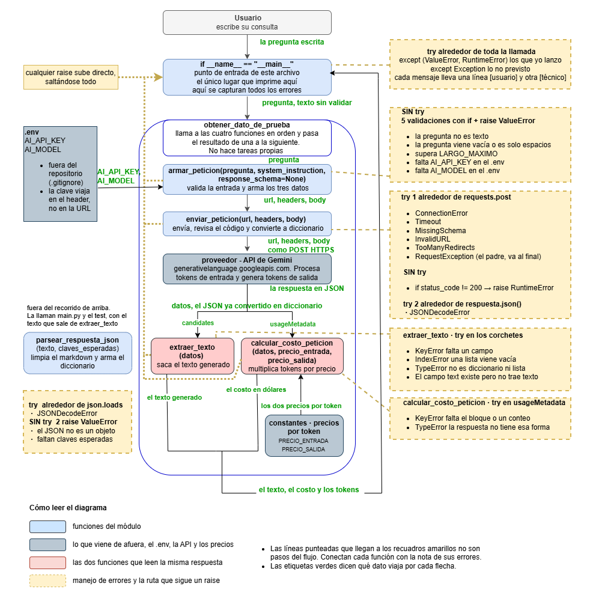

# Asistente de consultas laborales

Miniaplicación en Python que responde preguntas sobre normativa
laboral chilena y extrae datos de contratos de trabajo, consultando
la API REST de Google Gemini y devolviendo siempre una estructura de
datos que el código puede usar directamente.

| | |
|---|---|
| **Programa** | Especialización en Desarrollo con IA Generativa · Accenture y Skillnest |
| **Entrega** | Gate 1 · Habilitación técnica · Módulo 1 |
| **Participante** | Lorena De La Riva |
| **Repositorio** | https://github.com/LDeLaRiva/replica |
| **Modelo** | `gemini-3.5-flash-lite` vía API REST directa |

---

## Alcance

La aplicación resuelve cuatro tareas sobre normativa laboral
chilena, cada una con su propio prompt y su propio esquema de
salida.

- Responde una consulta sobre normativa laboral e indica de qué
  documento y artículo proviene la respuesta.
- Extrae de un contrato de trabajo la fecha de inicio, el sueldo
  base, la jornada semanal y si es de plazo indefinido, que son los
  datos de los que dependen las reglas aplicables a ese contrato.
- Describe de forma estructurada lo que establece una cláusula, con
  su materia, su valor y su unidad, sin pronunciarse sobre su
  legalidad.
- Identifica qué materias aborda un contrato, usando un vocabulario
  cerrado derivado del artículo 10 del Código del Trabajo.
Las cuatro devuelven JSON validado, no texto libre, y con los
valores tipados. Un número vuelve como número y un booleano como
booleano, de modo que el programa pueda usarlos sin volver a
interpretar texto. Cruzar los datos de un contrato con la norma para
responder sobre un caso concreto no está implementado todavía y es
el trabajo siguiente del proyecto.

Los límites del proyecto, incluidos los que están medidos, se
detallan en [Limitaciones conocidas](#limitaciones-conocidas).

---

## Requisitos previos

- **Python 3.13**, que es la versión con la que se desarrolló y se
  verificó el proyecto. La versión instalada se consulta con
  `python --version` en Windows o `python3 --version` en macOS y
  Linux.
- **Git**, para clonar el repositorio.
- **Una credencial de la API de Google Gemini**, que se obtiene sin
  costo en https://aistudio.google.com/apikey . El plan gratuito es
  suficiente para ejecutar este proyecto.
Las dependencias están declaradas en `requirements.txt` y se
instalan en el paso 3. El código importa dos librerías externas,
`requests` y `python-dotenv`. El resto corresponde a la biblioteca
estándar de Python.

---

## Instalación y ejecución

La instalación consta de seis pasos. Los comandos se entregan
completos.

### Paso 1 · Clonar el repositorio

```bash
git clone https://github.com/LDeLaRiva/replica.git replica
cd replica
```

El nombre al final del comando fija cómo se llama la carpeta, de
modo que el `cd` funciona igual en Windows, macOS y Linux.

### Paso 2 · Crear y activar el entorno virtual

**Windows (PowerShell)**

```powershell
python -m venv .venv
Set-ExecutionPolicy -Scope Process -ExecutionPolicy Bypass
.\.venv\Scripts\Activate.ps1
```

> La instrucción `Set-ExecutionPolicy` afecta únicamente a esta
> ventana de PowerShell y no modifica la configuración del sistema.
> Es necesaria porque Windows bloquea por defecto el script que
> activa el entorno, y sin ella la activación falla con el mensaje
> *la ejecución de scripts está deshabilitada*.

**macOS, Linux o WSL**

```bash
python3 -m venv .venv
source .venv/bin/activate
```

El entorno queda activado cuando aparece `(.venv)` al inicio de la
línea de comandos.

### Paso 3 · Instalar las dependencias

```bash
pip install --upgrade pip
pip install -r requirements.txt
```

### Paso 4 · Configurar la credencial

> [!IMPORTANT]
> Sin este paso la aplicación no se ejecuta. El archivo `.env`
> contiene la credencial, está excluido del repositorio y por lo
> tanto no existe después de clonar. Es además el único paso que no
> consiste en correr un comando, de modo que es el que más se pasa
> por alto. Al faltar, el programa se detiene con el mensaje
> `Falta AI_API_KEY en el .env`.

Copiar la plantilla.

**Windows (PowerShell)**

```powershell
Copy-Item .env.example .env
```

**macOS, Linux o WSL**

```bash
cp .env.example .env
```

Abrir el archivo `.env` recién creado y escribir la credencial
después del signo igual, sin comillas y sin espacios.

```dotenv
AI_API_KEY=clave_real_aqui
AI_MODEL=gemini-3.5-flash-lite
```

> [!NOTE]
> **En Windows**, el archivo debe llamarse exactamente `.env` y no
> `.env.txt`. El comando `Copy-Item` indicado arriba lo nombra
> correctamente. Si se crea manualmente con el Bloc de notas,
> conviene verificar la extensión.

> [!NOTE]
> **Sobre el valor de `AI_MODEL`.** Se lee desde el `.env` y puede
> cambiarse sin tocar el código, pero únicamente por otro modelo de
> Gemini que genere texto. La aplicación construye las peticiones y
> lee las respuestas con el formato propio de la API de Gemini, de
> modo que un modelo de otro proveedor no funcionaría sin reescribir
> `armar_peticion`, `extraer_texto` y `calcular_costo_peticion`.
>
> Google renueva y retira versiones de forma periódica, y la
> habilitación depende de cada cuenta, por lo que una credencial
> puede recibir un error 404 con un modelo que en otra cuenta
> responde con normalidad. Una alternativa estable es
> `gemini-flash-latest`, que apunta a la versión vigente de la
> familia.
>
> Al reemplazarlo por otro modelo de Gemini conviene tener presente
> tres cosas. No todos admiten `responseSchema`, que es lo que
> fuerza la salida estructurada. Los precios por token están fijos
> en `src/consumir_gemini.py` con los valores de
> `gemini-3.5-flash-lite`, así que el costo mostrado dejaría de
> corresponder. Y las mediciones de consistencia del banco se
> hicieron con ese mismo modelo.

### Paso 5 · Ejecutar la aplicación

```bash
python main.py
```

En macOS, Linux o WSL, `python3 main.py`.

### Paso 6 · Medir la consistencia del banco de prompts

```bash
python -m prompts.test_consistencia
```

Ejecuta los cuatro prompts cinco veces cada uno contra la API real y
cuenta cuántas respuestas llegaron con la estructura esperada. Son
veinte llamadas y tarda alrededor de cuatro minutos, con pausas de
cinco segundos entre una y otra para no agotar la cuota del plan
gratuito. Al terminar actualiza `prompts/registro_resultados.json`.

Este paso es opcional para comprobar el funcionamiento de la
aplicación. El resultado de la última medición está versionado en el
repositorio.

---

## Salida esperada

Una consulta real a la API, con la respuesta en bruto y la misma
respuesta ya convertida en diccionario de Python.

```text
Consulta
  ¿Cuántos días de permiso me corresponden por el fallecimiento
  de un hijo?

Texto crudo, tal como llegó   <class 'str'>
  {"respuesta": "En caso de fallecimiento de un hijo, al
  trabajador le corresponden diez días corridos de permiso
  pagado.", "fuente": "Código del Trabajo artículo 66"}

Ya convertido en diccionario   <class 'dict'>
  respuesta  En caso de fallecimiento de un hijo, al trabajador le
             corresponden diez días corridos de permiso pagado.
  fuente     Código del Trabajo artículo 66

Consumo de esta petición
  Tokens de entrada  214
  Tokens de salida   38
  Total de tokens    252
  Costo estimado     0.00015920 USD

Proceso terminado.
```

El contenido varía en cada llamada. La ejecución es correcta cuando
los dos tipos impresos son `str` arriba y `dict` abajo, y cuando no
aparece ningún `Traceback`, que es el bloque de error que Python
imprime cuando algo falla sin estar previsto.

Esa diferencia es la demostración central del proyecto. A simple
vista las dos salidas son casi idénticas, y sin embargo la primera
es una cadena de texto sobre la que no se puede pedir una clave,
mientras que la segunda es una estructura que el código indexa
directamente.

### Ejecutar otro prompt del banco

`main.py` ejecuta un prompt por vez. Para cambiarlo se modifican dos
constantes al comienzo del archivo.

```python
PREGUNTA = "El texto o la pregunta que se quiera enviar"
NOMBRE_PROMPT = "extraer_datos_contrato"
```

Los nombres disponibles son `responder_consulta`,
`extraer_datos_contrato`, `revisar_clausula` y
`listar_materias_contrato`. Si el nombre no existe en el banco, el
programa lo informa y lista los disponibles.

---

## Verificación de los criterios no compensables

Los cuatro criterios que el Gate 1 evalúa aparte del promedio
ponderado. Para cada uno se indica la evidencia en el proyecto y el
comando que permite comprobarlo.

| Criterio | Evidencia en el proyecto | Comprobación |
|---|---|---|
| Que la API funcione | peticiones reales contra `gemini-3.5-flash-lite`, con respuesta, tokens y costo | `python main.py` |
| Que el entorno sea reproducible | `requirements.txt` con versiones fijas, verificado con el ensayo de instalación limpia | `pip install -r requirements.txt` en un entorno virtual nuevo |
| Que las credenciales no queden expuestas | `.env` excluido en `.gitignore`, historial auditado sin ningún commit | `git log --all --oneline -- .env` no devuelve resultados |
| Que el código sea ejecutable | probado en el flujo normal y contra escenarios de error del servicio y de la respuesta | `python main.py` termina sin `Traceback` |

Comprobación adicional de seguridad.

**Windows (PowerShell)**

```powershell
git ls-files | findstr .env
```

**macOS, Linux o WSL**

```bash
git ls-files | grep .env
```

El único resultado debe ser `.env.example`.

---

## Arquitectura

*Actualizado para el Gate 1.*

El diagrama cubre `src/consumir_gemini.py`, que es donde ocurre
todo el consumo de la API.



El repositorio conserva además `docs/diagrama_arquitectura.png`, que
es la versión del Bloque 8. Se mantiene porque corresponde a la
entrega de esa actividad y porque otro documento la referencia.

El consumo de la API está separado en funciones con una
responsabilidad cada una.

| Función | Responsabilidad |
|---|---|
| `armar_peticion` | valida la entrada y construye la url, los headers y el cuerpo |
| `enviar_peticion` | envía, revisa el código de respuesta y convierte a diccionario |
| `extraer_texto` | obtiene el texto generado desde la respuesta de la API |
| `parsear_respuesta_json` | limpia, interpreta y verifica que estén las claves esperadas |
| `calcular_costo_peticion` | convierte los tokens informados por la API en el costo de la llamada |

`src/consumir_gemini.py` conserva comentada la función
`medir_latencia`, que produjo los datos de latencia y costo de
`docs/decision-arquitectura.md`. No forma parte de la aplicación,
es un instrumento de medición, y por esa razón tampoco figura en el
diagrama. Se mantiene en el repositorio para que los datos de ese
documento sean reproducibles.

### Estructura del repositorio

```text
main.py                     punto de entrada
requirements.txt            dependencias con versiones fijas
.env.example                plantilla de configuración
.gitignore                  excluye .env, el entorno virtual y las cachés
README.md                   este documento

src/
  consumir_gemini.py        consumo de la API y manejo de errores
  contraste.py              salida con color para la terminal

prompts/
  banco.py                  los cuatro prompts del proyecto
  test_consistencia.py      la medición de consistencia
  registro_resultados.json  resultado de la última medición

docs/
  diagrama_arquitectura_actualizado.png  el diagrama al día del Gate 1
  diagrama_arquitectura.png              la versión del Bloque 8, que
                                         se conserva como entrega de
                                         esa actividad
  decision-arquitectura.md               comparación de modelos y costos
  ajustes-prompts.md                     las ocho iteraciones de los prompts
  U1.2_B4_evidencia_peticion_autenticada.png
  U1.2_B4-2_evidencia_peticion_autenticada.png
```

El archivo `.env` no aparece en la lista porque nunca se versiona.
Se crea localmente en el paso 4.

---

## Criterios de diseño

### Los mensajes de error tienen dos destinatarios

Los errores que el módulo lanza llevan dos líneas. La marcada con
`[usuario]` es para quien usa el programa y la marcada con
`[técnico]` para quien lo mantiene.

```text
[usuario] No pudimos completar tu consulta. Intenta nuevamente en
unos minutos.
[técnico] El servicio respondió 429: RESOURCE_EXHAUSTED quota
```

El criterio distingue tres situaciones. Cuando la persona puede
resolver el problema, la línea de usuario le indica cómo. Cuando no
puede resolverlo pero reintentar es razonable, recibe el mensaje
genérico. Cuando el error solo puede originarse en el código, no
lleva línea de usuario, porque no hay usuario capaz de resolverlo.

Esa tercera situación no corresponde a ningún `raise` del módulo,
sino al `except Exception` del borde, que informa el tipo de la
excepción y nada más.

Por ahora las dos líneas se imprimen juntas, dado que la aplicación
corre en terminal y todavía no existe una interfaz que las separe.

### El manejo de errores reside en el borde

Las funciones del módulo lanzan excepciones pero no imprimen. El
único que imprime es `main.py`, por ser el único que conoce cómo
presentar información a una persona. Capturar `Exception` dentro de
una función ocultaría errores de programación precisamente donde
deben verse.

### El módulo de color es propio y sin dependencias

`src/contraste.py` genera los colores en RGB exacto, sin librerías
externas. Es una decisión de accesibilidad. Los contrastes de alta
luminancia, como el texto blanco o los colores saturados sobre fondo
oscuro, dificultan la lectura a quienes tienen fotosensibilidad. Por
eso los tonos usan texto oscuro sobre fondos suaves, definidos para
una terminal de fondo claro.

Los atajos siguen un patrón de familia y terminación. Por ejemplo
`exitobn` es verde con barra y negrita, y `notat` presenta una tabla
de clave y valor en el tono reservado a las notas.

### El banco de prompts está escrito y medido

Cada prompt reúne en un solo lugar su nombre, su instrucción
completa, un ejemplo de entrada, las claves que espera y el esquema
JSON que la API debe cumplir. De esa forma ninguna parte del código
construye instrucciones por su cuenta.

Las instrucciones siguen la estructura RTCF, es decir rol, tarea,
contexto y formato. Mantener el mismo orden en las cuatro evita que
cada tarea adopte un criterio distinto.

La actividad establecía un mínimo de tres prompts y tres
repeticiones. Este banco contiene cuatro prompts y mide cinco
repeticiones.

### La salida estructurada se fuerza en la API

Solicitar al modelo que responda en JSON es una sugerencia. Además
de solicitarlo, cada petición viaja con `responseMimeType` y
`responseSchema` dentro de `generationConfig`, que es una
restricción aplicada por la API al generar la respuesta. Aun así el
código limpia, interpreta y valida, porque ninguno de los dos
mecanismos constituye una garantía.

### Los datos de ejemplo son ficticios

El contrato que utilizan dos de los prompts es inventado y no
contiene información de ninguna empresa ni de ninguna persona real.
El corpus normativo del proyecto es público, el Código del Trabajo y
los dictámenes de la Dirección del Trabajo.

---

## Documentación del proyecto

- **[docs/decision-arquitectura.md](docs/decision-arquitectura.md)**
  Comparación entre dos modelos candidatos con datos reales de
  latencia, tokens y costo, y la justificación de la elección.
- **[docs/ajustes-prompts.md](docs/ajustes-prompts.md)**
  Las diez mediciones de consistencia y las ocho iteraciones
  aplicadas a los prompts. Incluye dos iteraciones que no
  funcionaron y se revirtieron, con la explicación correspondiente.
  El documento registra además el límite de la medición, dado que
  con cinco repeticiones no se distingue una tasa de fallas del
  20 % de una del 40 %.
---

## Limitaciones conocidas

Los límites de esta versión, separados en dos grupos. Primero lo que
quedó fuera del alcance por decisión, y después lo que el modelo no
resuelve bien, con la medición correspondiente y lo que cada caso
necesita para cerrarse.

### Fuera del alcance de esta etapa

**La aplicación no evalúa legalidad.** Es una decisión de diseño. El
modelo describe lo que un texto establece y el juicio sobre si eso
cumple la ley corresponde al programa, que compara contra el texto
legal y por lo tanto no puede inventarlo. Esa comparación requiere
una tabla de límites legales, que es la dependencia registrada en
`docs/ajustes-prompts.md` para cerrar el vocabulario de
`revisar_clausula`.

**No conserva historial ni mantiene conversación.** Cada consulta es
independiente. Tampoco dispone de interfaz gráfica, dado que la
etapa corresponde a la miniaplicación de consola.

### Lo que el modelo no resuelve bien

**El modelo no consulta la ley, la reconstruye desde su
entrenamiento.** Puede citar un artículo equivocado o agregar una
regla que el artículo citado no contiene. Sobre cuarenta respuestas
medidas, once agregaron contenido que la pregunta no solicitaba y
una presentó un error de fondo. El procedimiento de medición está en
`docs/ajustes-prompts.md`.

Esto se corrige entregando el texto de la norma junto con la
pregunta, de modo que el modelo responda desde esa fuente y no desde
su memoria. Es el trabajo siguiente del proyecto.

**La cita a nivel de inciso no es confiable.** El número de inciso no
es contenido de la norma, es una propiedad de cómo está dispuesto el
texto y se obtiene contando párrafos. El modelo no cuenta, repite la
etiqueta que acompañaba al dato en los textos con que fue entrenado.

Por eso el campo `fuente` se limita al documento y al artículo, que
es el nivel en el que la cita sí resultó estable en la medición.
Descender al inciso depende de la misma incorporación del texto de
la norma.

**La prueba de consistencia mide la forma, no la veracidad.**
Verifica que la respuesta traiga las claves esperadas, de modo que
una respuesta equivocada con la estructura correcta se cuenta como
válida. Por esa razón las iteraciones documentadas se apoyan en
revisar las respuestas una por una y no solo en el conteo.

---

## Registro del ensayo de instalación limpia

Verificación de que el proyecto se instala y ejecuta desde cero, en
una carpeta nueva, siguiendo únicamente este documento.

- **Fecha** · 23 de octubre de 2026
- **Procedimiento** · clonado en limpio del repositorio remoto en una
  carpeta vacía, entorno virtual nuevo, instalación exclusivamente
  desde `requirements.txt`, `.env` creado a partir de la plantilla, y
  ejecución de `main.py` y de la prueba de consistencia siguiendo los
  seis pasos de este README.
- **Hallazgos** · dos imprecisiones en la documentación, ninguna
  bloqueó la instalación ni la ejecución. La tabla del encabezado de
  este README conservaba el marcador `USUARIO/REPOSITORIO` sin
  reemplazar. El comentario de `.env.example` nombraba proveedores
  que el proyecto no utiliza.
- **Corrección aplicada** · se reemplazó el marcador por la dirección
  real del repositorio y se reescribió el comentario de
  `.env.example` indicando el proveedor correcto y dónde obtener la
  credencial.
- **Resultado** · la instalación completó sin errores con los
  veintiséis paquetes declarados. `main.py` devolvió una respuesta
  real del modelo con su costo. La prueba de consistencia obtuvo
  20 de 20 respuestas válidas. `git status` dentro del clon confirmó
  que `.env`, el entorno virtual y las cachés quedan excluidos.
---

## Errores frecuentes

| Mensaje | Causa |
|---|---|
| `la ejecución de scripts está deshabilitada` | falta la instrucción `Set-ExecutionPolicy` del paso 2 |
| `ModuleNotFoundError` | falta el paso 3, o el entorno virtual no está activado |
| `Falta AI_API_KEY en el .env` | el archivo `.env` no existe o la línea está vacía |
| `Falta AI_MODEL en el .env` | el archivo `.env` no existe o la línea del modelo está vacía |
| `El servicio respondió 400` | la credencial no es válida |
| `El servicio respondió 404` | la cuenta no tiene habilitado ese modelo, ver el paso 4 |
| `El servicio respondió 429` | se agotó la cuota por minuto, reintentar en unos segundos |
| `No hay conexión` | no hay acceso a internet |

Ninguno de estos detiene el programa de forma abrupta. La aplicación
muestra el mensaje y termina.