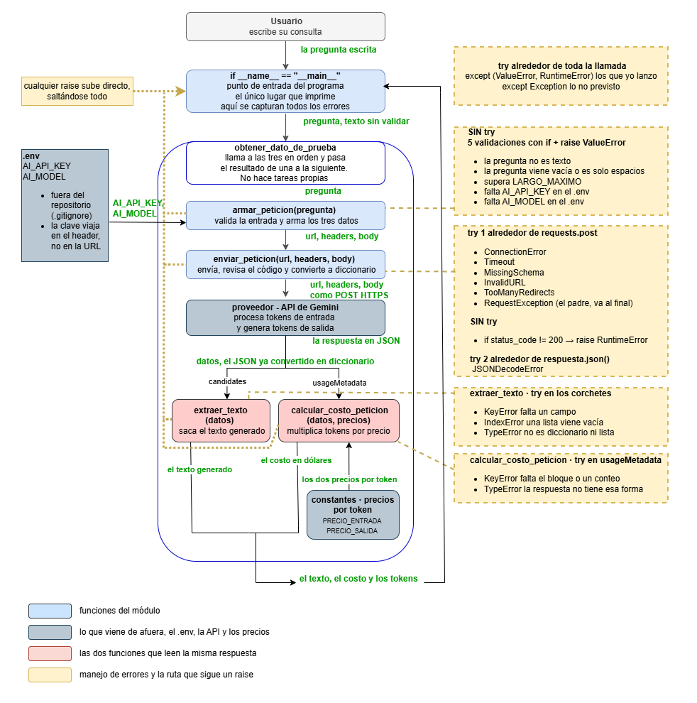

# Decisión de arquitectura · elección de modelo
 
**Fecha de la comparación** · 20 y 21 de octubre de 2026  
**Módulo evaluado** · `src/consumir_gemini.py`  
**Restricción de esta etapa** · solo modelos disponibles en la capa gratuita de Gemini
 
Esta restricción corresponde a la etapa actual del proyecto, no a una definición
permanente de arquitectura. Si el proyecto avanzara a producción, la comparación
debería rehacerse incorporando modelos de pago, que hoy quedan fuera del alcance
por presupuesto y no por falta de mérito técnico.
 
> ### Resumen
>
> **Decisión** · se adopta **Gemini 3.5 Flash-Lite** (`gemini-3.5-flash-lite`)
> como modelo de la miniaplicación.
>
> **Motivo principal** · responde en 1,59 s promedio frente a 5,05 s del
> candidato alternativo, con una variabilidad de 15 % frente a 46 %, y
> respondió en las 31 llamadas que se le hicieron.
>
> **Alcance de la evaluación** · 4 modelos de generación de texto evaluados, más
> la línea Pro y Gemini 4 Argon descartados por no estar disponibles en esta
> cuenta. Más de 60 llamadas reales a la API entre el 20 y el 21 de octubre
> de 2026.
 
---
 
## Contenido
 
- **[Modelo elegido](#modelo-elegido)**
- **[Diagrama de arquitectura](#diagrama-de-arquitectura)**
- **[Comparación de candidatos](#comparación-de-candidatos)**
  - [Cómo se seleccionaron los candidatos](#cómo-se-seleccionaron-los-candidatos)
  - [Origen de cada dato](#origen-de-cada-dato)
  - [Preguntas de prueba usadas](#preguntas-de-prueba-usadas)
  - [Escala de calidad](#escala-de-calidad)
  - [Cómo se mide la variabilidad](#cómo-se-mide-la-variabilidad)
  - [Tabla comparativa](#tabla-comparativa)
  - [Qué se observó en cada pregunta](#qué-se-observó-en-cada-pregunta)
- **[Justificación](#justificación)**
  - [Qué pesa más en este caso, y por qué](#qué-pesa-más-en-este-caso-y-por-qué)
  - [Matriz de decisión](#matriz-de-decisión)
  - [Sensibilidad de la nota de jurisdicción](#sensibilidad-de-la-nota-de-jurisdicción)
  - [La decisión](#la-decisión)
- **[Alternativa descartada y por qué](#alternativa-descartada-y-por-qué)**
  - [Gemini 4 Argon y la línea Pro](#gemini-4-argon-y-la-línea-pro)
  - [Gemini 3.8 Flash](#gemini-38-flash)
  - [Gemini 3.6 Flash](#gemini-36-flash)
  - [Gemini 3.1 Flash-Lite](#gemini-31-flash-lite)
  - [El patrón de la capa gratuita](#el-patrón-de-la-capa-gratuita)
- **[Limitaciones detectadas y trabajo siguiente](#limitaciones-detectadas-y-trabajo-siguiente)**
  - [Atribución de fuentes](#atribución-de-fuentes)
  - [El prompt de sistema no fija la jurisdicción](#el-prompt-de-sistema-no-fija-la-jurisdicción)
  - [El cálculo de costo no contempla tokens de razonamiento](#el-cálculo-de-costo-no-contempla-tokens-de-razonamiento)
  - [Capacidad, concurrencia y techo real de la aplicación](#capacidad-concurrencia-y-techo-real-de-la-aplicación)
  - [Manejo de errores](#manejo-de-errores)
  - [Privacidad](#privacidad)
- **[Fuentes consultadas](#fuentes-consultadas)**
---
 
## Modelo elegido
 
**Gemini 3.5 Flash-Lite** · `gemini-3.5-flash-lite`
 
---
 
## Diagrama de arquitectura
 

 
El diagrama corresponde al mismo módulo medido en este documento. El modelo se
configura en la variable `AI_MODEL` del archivo `.env`, de modo que probar otro
candidato no obliga a reescribir ninguna función. Sí exige actualizar las dos
constantes de precio del módulo, porque cada modelo cobra distinto. 
---
 
## Comparación de candidatos
 
### Cómo se seleccionaron los candidatos
 
No se compararon dos modelos elegidos de antemano. Se tomó como punto de
partida el catálogo completo que entrega la API para esta credencial sobre el que se aplicaron
sucesivos criterios de descarte.
 
| Filtro aplicado | Qué quedó fuera |
|---|---|
| Debe estar disponible para esta cuenta | Gemini 4 Argon, Gemini 3.1 Pro y toda la línea Pro, que la consola muestra con límite 0 |
| Debe generar texto | modelos de imagen, audio, música, embeddings y agentes |
| Debe tener precio publicado | `gemini-3.5-flash` y `gemini-3.7-flash`, que aparecen en la API pero no en la documentación de precios |
| Debe ser estable, no Preview | `gemini-3-flash-preview` |
| Debe responder de forma utilizable | Gemini 3.8 Flash y Gemini 3.6 Flash |
 
Los dos modelos que superaron todos los filtros son **Gemini 3.5 Flash-Lite** y
**Gemini 3.1 Flash-Lite**, y son los que se comparan en detalle. El resto está
documentado en la sección de alternativas descartadas.
 
### Origen de cada dato
 
| Dato | Origen |
|---|---|
| Precio por token | página de precios de Gemini, consultada el 21-10-2026 |
| Límites de la capa gratuita | consola propia en `aistudio.google.com/rate-limit` |
| Tokens de entrada y salida | `usageMetadata` de cada respuesta real |
| Costo | calculado con `calcular_costo_peticion` del propio módulo |
| Latencia | `time.perf_counter`, 10 mediciones por modelo |
| Disponibilidad | respuestas correctas sobre intentos realizados |
| Calidad | 3 preguntas de prueba, escala de 1 a 3 en tres atributos |
 
El precio es el único dato que no generé yo. Todo lo demás proviene de
mediciones propias.
 
Las mediciones de latencia se hicieron con la función `medir_latencia`, que
llama a las mismas funciones del módulo que usa la aplicación. Los tiempos corresponden
entonces a los que la miniaplicación experimenta efectivamente, y no a los de
un script de prueba independiente.
 
Esa función no aparece en el diagrama de arquitectura porque no forma parte de
la aplicación. Es una herramienta de medición, se usó para producir los datos
de este documento y queda en el módulo **comentada**, disponible por si se
necesita repetir o ampliar las mediciones más adelante.
 
### Preguntas de prueba usadas
 
Las tres son del dominio real de la aplicación, consultas de legislación
laboral chilena, y las tres tienen respuesta verificable en el Código del
Trabajo.
 
| | Pregunta | Qué mide |
|---|---|---|
| **P1** | ¿Qué establece el artículo 67 del Código del Trabajo sobre el feriado anual? | si cita bien la norma o le atribuye contenido ajeno |
| **P2** | Un trabajador con contrato indefinido lleva 4 años y 7 meses y es despedido por necesidades de la empresa. ¿Qué indemnizaciones le corresponden y cómo se calculan? | si resuelve un caso de varios pasos encadenados |
| **P3** | ¿Es verdad que en Chile el finiquito debe firmarse dentro de las 24 horas siguientes al despido? | si detecta una premisa falsa o la sigue |
 
Las respuestas se verificaron contra el texto del Código del Trabajo publicado
por la Biblioteca del Congreso Nacional y contra dictámenes de la Dirección del
Trabajo.
 
**Qué mide y qué no mide la pregunta 2.** La miniaplicación no delega los
cálculos al modelo. Los montos se resuelven con fórmulas deterministas en el
propio código, porque la aritmética de un modelo de lenguaje no es verificable
ni reproducible entre una ejecución y otra. La pregunta no evalúa entonces su
capacidad de calcular, sino si **identifica el marco legal correcto** y si
**explica bien las reglas** que la aplicación va a aplicar por su cuenta. El
caso numérico se incluyó porque obliga a encadenar varias reglas en orden, no
porque la aplicación vaya a usar el número que entregue.
 
### Escala de calidad
 
Cada respuesta recibe tres notas independientes, de 1 a 3.
 
| Nota | Concreta | Lógica | No alucina |
|---|---|---|---|
| **1** | da rodeos, no responde lo preguntado | se contradice o no se sostiene | inventa artículos, cifras o plazos |
| **2** | responde, pero con relleno o incompleto | se sostiene con saltos | no inventa, pero afirma de más sin respaldo |
| **3** | responde directo lo preguntado | el razonamiento se sigue completo | se apega a lo verificable |
 
### Cómo se mide la variabilidad
 
La latencia promedio por sí sola no describe bien a un modelo. Dos modelos
pueden promediar lo mismo y comportarse de manera opuesta, uno respondiendo
siempre en un tiempo semejante y el otro alternando entre extremos muy
distantes entre sí.
 
Para capturar eso se usa la **variabilidad**, que es la desviación estándar de
las diez mediciones dividida por su promedio, expresada en porcentaje. En
estadística se conoce como coeficiente de variación.
 
| Variabilidad | Qué significa |
|---|---|
| baja, cerca del 10 % | los tiempos se parecen entre sí, el modelo es predecible |
| alta, sobre el 40 % | los tiempos se dispersan mucho, no se sabe cuánto va a tardar la próxima vez |
 
Desde la perspectiva de quien usa la aplicación, la predictibilidad importa
tanto como la velocidad. Esperar siempre alrededor de dos segundos se tolera
bien. Esperar a veces dos y a veces nueve, sin saber cuál toca, se percibe como
un servicio poco confiable aunque el promedio no sea tan distinto.
 
### Tabla comparativa
 
| Criterio | Gemini 3.1 Flash-Lite | Gemini 3.5 Flash-Lite |
|---|---|---|
| Costo por 1000 tokens de entrada | 0,00025 USD | 0,00030 USD |
| Costo por 1000 tokens de salida | 0,00150 USD | 0,00250 USD |
| Costo real de la consulta medida | 0,00003925 USD | 0,00007250 USD |
| Tokens de entrada / salida medidos | 25 / 22 | 25 / 26 |
| Tokens de razonamiento no incluidos en candidatesTokenCount | ninguno | ninguno |
| Latencia promedio, 10 mediciones | **5,05 s** | **1,59 s** |
| Latencia mínima y máxima | 1,76 s — 8,83 s | 0,94 s — 1,76 s |
| Variabilidad de la latencia | **46 %** | **15 %** |
| Respuestas correctas sobre intentos, en las corridas de medición | 14 de 16 cortas, 0 de 3 largas | 31 de 31 |
| Límite capa gratuita | 15 por minuto, 500 por día | 15 por minuto, 500 por día |
| Calidad P1 · concreta / lógica / no alucina | 2 / 3 / 1 | 2 / 3 / 1 |
| Calidad P2 · concreta / lógica / no alucina | 1 / 3 / 2 | 3 / 3 / 3 |
| Calidad P3 · concreta / lógica / no alucina | 3 / 3 / 3 | 3 / 3 / 3 |
| **Calidad total** | **21 de 27** | **24 de 27** |
 
*Mediciones realizadas el 20 y el 21 de octubre de 2026. Precios consultados el
21 de octubre de 2026 en la página oficial de Gemini. Tanto los precios como el
comportamiento de los modelos cambian con el tiempo, por lo que esta tabla
pierde validez como evidencia a medida que pasen los meses.*
 
### Qué se observó en cada pregunta
 
**P1 · resultados equivalentes, y ambos con fallas.** Los dos atribuyeron al
artículo 67 contenido de otros artículos, y cada uno inventó un dato.
 
| | Artículos ajenos que incorporó | Dato inventado |
|---|---|---|
| 3.5 Flash-Lite | 68 y 69 | un tope de "tres nuevos empleadores", cuando el artículo 68 lo fija en diez años prestados a empleadores anteriores |
| 3.1 Flash-Lite | 69, 70, 71 y 73 | atribuyó a la acumulación de períodos una compensación que el artículo 73 refiere al exceso del artículo 68 |
 
Ninguno de los dos mencionó los veinte días hábiles que el propio artículo 67
concede en Magallanes, Aysén y la provincia de Palena.
 
**P2 · aquí se produjo la diferencia.** Gemini 3.5 Flash-Lite reconoció que "necesidades de
la empresa" es terminología del Código del Trabajo chileno, lo declaró
explícitamente y resolvió el caso completo. Sus once afirmaciones sustantivas son
correctas contra el texto de los artículos 161, 162, 163, 172, 73 y 177. El
único error fue escribir "Inspectoría del Trabajo" donde el Código dice
"Inspección del Trabajo". Gemini 3.1 Flash-Lite, ante la misma
pregunta, respondió con el Estatuto de los Trabajadores de España.
 
Conviene matizar. **La pregunta no indicaba el país**, así que parte de la
responsabilidad recae en el prompt de sistema, y Gemini 3.1 Flash-Lite declaró
al final que se basaba en legislación española. No inventó normas, aplicó
normas reales de otra jurisdicción. Aun así, Gemini 3.5 Flash-Lite leyó la
pista que había en el enunciado y la explicó, mientras que Gemini 3.1
Flash-Lite, que en las preguntas 1 y 3 sí identificó Chile correctamente, aquí
no lo hizo. Su criterio en esta materia es inconsistente entre una consulta y
otra.
 
**P3 · ambos la resolvieron correctamente.** Los dos rechazaron la premisa falsa, dieron
el plazo correcto de diez días hábiles del artículo 177 y agregaron el derecho a
formular reserva de derechos, que el artículo 162 contempla expresamente.
Gemini 3.1 Flash-Lite estuvo levemente mejor, porque citó el número del artículo
y explicó la consecuencia de firmar sin reserva.
 
---
 
## Justificación
 
### Qué pesa más en este caso, y por qué
 
El criterio para ordenar la importancia fue uno solo, **cuánto le cuesta al
usuario cada tipo de falla**.
 
| Falla | Consecuencia para quien consulta |
|---|---|
| El modelo alucina | la persona actúa sobre información legal falsa, reclama de menos o deja pasar un plazo |
| El modelo no está disponible | no recibe ninguna respuesta |
| El modelo es lento o impredecible | espera más, pero obtiene la respuesta correcta |
| El modelo es más caro | a la escala actual la diferencia es de centavos, aunque crece con el volumen |
 
Una respuesta legal inventada no es una respuesta peor, es una respuesta
dañina. Por eso la calidad, y en particular el atributo de no alucinar, pesa
más que todo lo demás.
 
La latencia importa y no debe subestimarse. El problema medido
no es que un modelo sea algo más lento, es que uno de los dos tarda entre 1,76 y
8,83 segundos sin que se pueda anticipar cuál extremo va a tocar, y una espera
de casi nueve segundos frente a una pantalla en blanco se percibe como que la
aplicación falló. Recibe menos peso que la calidad por una sola razón, que una
respuesta lenta sigue siendo correcta y una rápida equivocada no, pero queda al
mismo nivel que la disponibilidad.
 
El precio en dólares es el criterio que menos separa **en la escala actual del
proyecto**, pero eso cambia si la aplicación crece o si se le permite recibir
documentos.
 
| Tipo de consulta | 1.000 al mes | 10.000 al mes | 50.000 al mes |
|---|---|---|---|
| consulta simple · 1.500 / 600 tokens | 0,67 USD | 6,75 USD | 33,75 USD |
| con un contrato adjunto · 3.000 / 900 | 1,05 USD | 10,50 USD | 52,50 USD |
| con contrato y respuesta extensa · 3.000 / 1.800 | 2,25 USD | 22,50 USD | 112,50 USD |
 
*Diferencia mensual entre Gemini 3.5 Flash-Lite y Gemini 3.1 Flash-Lite.*
 
Por eso recibe el peso más bajo en la matriz, y por eso mismo **ese peso
quedaría obsoleto si el proyecto escalara**.
 
### Matriz de decisión
 
Las notas de calidad son el promedio de las nueve notas de cada modelo, 21 y 24
sobre 27, divididas por 9. Las demás se asignan de 1 a 3 según los datos
medidos. La columna ponderada es la nota multiplicada por el peso.
 
| Criterio | Peso | 3.1 Flash-Lite | Ponderado | 3.5 Flash-Lite | Ponderado |
|---|---|---|---|---|---|
| Calidad, con énfasis en no alucinar | 50 % | 2,33 | 1,17 | 2,67 | 1,33 |
| Disponibilidad | 20 % | 1,00 | 0,20 | 3,00 | 0,60 |
| Latencia y estabilidad | 20 % | 1,00 | 0,20 | 3,00 | 0,60 |
| Costo en dólares | 10 % | 3,00 | 0,30 | 2,00 | 0,20 |
| **Total** | **100 %** | | **1,87** | | **2,73** |
 
*Las notas de calidad se muestran redondeadas a dos decimales. Los valores
exactos son 21/9 = 2,333 y 24/9 = 2,667, y la columna ponderada y los totales
se calculan a partir de ellos.*
 
### Sensibilidad de la nota de jurisdicción
 
El error de jurisdicción de la pregunta 2 admite distintos grados de severidad,
según cuánta responsabilidad se atribuya al prompt y cuánta al modelo. Para
comprobar que la decisión no depende de ese juicio, se recalculó la matriz con
tres niveles.
 
| Severidad aplicada a la P2 del 3.1 | Total 3.1 | Total 3.5 |
|---|---|---|
| estricta · 1 / 3 / 1 | 1,81 | 2,73 |
| intermedia · 1 / 3 / 2 · la usada | 1,87 | 2,73 |
| benévola · 2 / 3 / 2 | 1,92 | 2,73 |
 
El resultado es el mismo en los tres casos. **La elección no se sostiene en ese
incidente**, sino en la latencia, la estabilidad y la disponibilidad, donde la
diferencia es mucho mayor y está respaldada por más mediciones.
 
### La decisión
 
Elijo **Gemini 3.5 Flash-Lite**. El peso de la decisión está en tres datos de
la tabla comparativa. Responde tres veces más rápido, con una variabilidad tres
veces menor, y contestó en las 31 llamadas que se le hicieron. Para una
aplicación que atiende consultas reales, un modelo que a veces tarda dos
segundos y a veces
nueve, y que algunas veces no responde, no es utilizable aunque sus respuestas
sean buenas cuando llegan.
 
Como observación adicional, en la pregunta que exige encadenar varias reglas,
Gemini 3.5 Flash-Lite identificó correctamente la jurisdicción chilena y explicó
las reglas aplicables sin error. Gemini 3.1 Flash-Lite explicó reglas de otro
país. Como los cálculos los resuelve el propio código y no el modelo, lo que
está en juego no es la aritmética sino **qué marco legal se le explica al
usuario**, que es más grave. Ese dato refuerza la decisión pero no la determina,
según se muestra en el análisis de sensibilidad anterior.
 
Gemini 3.1 Flash-Lite no es un mal modelo. En dos de las tres preguntas estuvo
igual o mejor, y es un 35 % más barato en tokens de salida. La decisión no es
que sea incompetente, es que no es predecible, y la diferencia de precio a la
escala actual del proyecto es de menos de un dólar al mes.
 
---
 
## Alternativa descartada y por qué
 
### Gemini 4 Argon y la línea Pro
 
Descartados por disponibilidad y por presupuesto. La consola de límites de esta
cuenta muestra **0 de 0** en peticiones por minuto, tokens por minuto y
peticiones por día para Gemini 4 Argon, Gemini 3.1 Pro y Gemini 2.5 Pro. No
están habilitados en la capa gratuita.
 
Usarlos exigiría habilitar facturación. El precio publicado de Gemini 4 Argon
es de 2,00 dólares por millón de tokens de entrada y 10,00 de salida, y sube a
4,00 y 20,00 a partir del 1 de diciembre de 2026. Comparado con el modelo
elegido, eso va de 4 veces más caro en tokens de salida hoy hasta 13 veces más
caro en tokens de entrada desde diciembre.
 
Como esta etapa del proyecto trabaja con presupuesto cero, un modelo que no se
puede desplegar hoy no es un candidato. **Eso no significa descartarlo de forma
definitiva.** Si el proyecto avanzara a producción, un modelo de pago bien
podría justificar su costo, y esta comparación debería rehacerse incluyéndolo.
Queda registrado aquí precisamente para que esa revisión parta desde un punto
documentado y no desde cero.
 
### Gemini 3.8 Flash
 
Descartado por indisponibilidad, en tres intentos realizados el 20 y el 21 de
octubre de 2026, con dos versiones distintas del código de medición.
 
| Intento | Resultado |
|---|---|
| 1 | `Timeout`, superó los 30 segundos definidos en el módulo |
| 2 | `503 UNAVAILABLE` — "This model is currently experiencing high demand" |
| 3 | `503 UNAVAILABLE`, sin alcanzar a completar una sola medición |
 
No completó ninguna medición de latencia ni de calidad. En las mismas corridas,
minutos antes y con la misma conexión, Gemini 3.5 Flash-Lite completó diez
llamadas consecutivas sin fallas, lo que descarta que el problema fuera la red
local.
 
### Gemini 3.6 Flash
 
Descartado por desempeño y por costo real.
 
| Medición | Resultado |
|---|---|
| Respuestas correctas | 6 de 10 |
| Latencia promedio | 4,04 s, contra 1,59 s del modelo elegido |
| Tokens de razonamiento no visibles en candidatesTokenCount | 346, para una respuesta visible de 19 tokens |
 
El hallazgo del razonamiento merece detalle. En las respuestas de este modelo,
`totalTokenCount` no coincide con la suma de `promptTokenCount` y
`candidatesTokenCount`. La diferencia corresponde a tokens de razonamiento, que
la página de precios de Gemini factura como tokens de salida. Para una respuesta
visible de 19 tokens, el modelo consumió 346 tokens razonando.
 
Eso significa que el costo real de este modelo es cerca de quince veces el que
arroja la fórmula basada solo en los tokens visibles, y explica además por qué
los modelos de la familia Flash son más lentos y por qué el proveedor los
rechaza antes bajo carga.
 
### Gemini 3.1 Flash-Lite
 
Es el candidato que se comparó en detalle y el que finalmente no se eligió.
Quedó fuera por tres razones concretas, todas medidas.
 
**Inestabilidad en la disponibilidad.** De 16 llamadas con preguntas de
respuesta corta respondió 14, y falló en los 3 intentos con preguntas de
respuesta larga, que son las que la aplicación necesita. Las fallas fueron
503 UNAVAILABLE y no siguieron ningún patrón reconocible, de modo que no se
pueden prever ni evitar desde el código.
 
**Latencia alta y, sobre todo, impredecible.** Promedió 5,05 segundos frente a
1,59 del modelo elegido, con mediciones que fueron desde 1,76 hasta 8,83
segundos. Una variabilidad de 46 % significa que quien consulta no puede saber
si esperará dos segundos o nueve.
 
**Inconsistencia en la jurisdicción.** Identificó correctamente la legislación
chilena en las preguntas 1 y 3, y respondió con legislación española en la
pregunta 2, sin que mediara ningún cambio en la configuración ni en el prompt
entre una consulta y otra.
 
Lo que el modelo tiene a favor queda consignado para que la decisión sea
revisable. Es un 35 % más barato en tokens de salida y en dos de las tres
preguntas de calidad obtuvo una puntuación igual o mejor que el modelo elegido.
No se descartó por incompetencia sino por falta de previsibilidad, y la
diferencia de precio a la escala actual del proyecto es inferior a un dólar
mensual.
 
### El patrón de la capa gratuita
 
Los límites de la cuenta muestran una diferencia estructural entre las dos
familias, no una condición pasajera de un modelo puntual.
 
| Familia | Peticiones por minuto | Peticiones por día |
|---|---|---|
| Flash · 3, 3.6, 3.8 | 5 | 20 |
| Flash-Lite · 3.1, 3.5 | 15 | 500 |
| Pro y Argon | 0 | 0 |
 
Ninguna aplicación que atienda usuarios reales puede operar con veinte
peticiones diarias. Esto por sí solo deja a toda la familia Flash fuera del alcance de
este proyecto mientras se mantenga en capa gratuita.
 
---
 
## Limitaciones detectadas y trabajo siguiente
 
### Atribución de fuentes
 
Los dos modelos finalistas fallaron en lo mismo, atribuir al artículo
consultado contenido que pertenece a otros artículos. Esto no se resuelve
cambiando de modelo, porque ambos responden desde su memoria de entrenamiento.
 
La solución es entregarle al modelo el texto literal del artículo y pedirle que
responda solo con ese fragmento. Ese enfoque se llama generación aumentada por
recuperación, RAG por sus siglas en inglés, y se aborda en el módulo siguiente.
 
### El prompt de sistema no fija la jurisdicción
 
La instrucción del módulo indica el idioma pero no el país.
 
```python
INSTRUCCION = "Responde siempre en idioma español."
```
 
El español se habla en más de veinte países con legislación laboral distinta.
Gemini 3.5 Flash-Lite infirió Chile a partir de la terminología de la pregunta,
pero Gemini 3.1 Flash-Lite respondió con legislación española. Ninguno de los
dos debió tener que inferirlo.
 
Queda pendiente ajustar esa instrucción para que fije de forma explícita la
jurisdicción y el marco normativo aplicable, y no solo el idioma. El cambio se
hará después de cerrada esta comparación, para no alterar las condiciones en
que se midieron ambos modelos.
 
### El cálculo de costo no contempla tokens de razonamiento
 
`calcular_costo_peticion` multiplica `candidatesTokenCount` por el precio de
salida. En los modelos Flash-Lite esa cifra es exacta, lo que se verificó en
todas las mediciones comparando `totalTokenCount` con la suma de entrada y
salida. En modelos con razonamiento, como Gemini 3.6 Flash, el cálculo
subestima el costo real. La función es correcta para el modelo elegido y tiene
un límite conocido si el proyecto migrara a un modelo que razone.
 
### Capacidad, concurrencia y techo real de la aplicación
 
El costo y los límites de uso responden a dos fenómenos distintos que conviene
no mezclar.
 
| | Depende de | Consecuencia si crece |
|---|---|---|
| **Volumen** | cuántas consultas en total | sube la factura, de forma predecible |
| **Concurrencia** | cuántas consultas al mismo tiempo | aparecen errores 429, la factura no cambia |
 
Cincuenta personas consultando a la misma hora cuestan lo mismo que cincuenta
repartidas en el día. El costo no distingue simultaneidad; los límites del
proveedor solo distinguen eso.
 
**El techo de esta aplicación en capa gratuita.**
 
Con Gemini 3.5 Flash-Lite la cuenta permite 15 peticiones por minuto y 500 por
día. El límite determinante es el diario, porque 15 por minuto equivaldrían a 21.600
diarias si pudieran sostenerse.
 
| Escenario | Resultado |
|---|---|
| 500 consultas al día, a 2 por persona | unas 250 personas diarias |
| 10 personas en el mismo minuto | las 10 atendidas |
| 30 personas en el mismo minuto | 15 atendidas, 15 reciben 429 |
| 60 personas en el mismo minuto | 15 atendidas, 45 reciben 429 |
 
El promedio diario puede resultar suficiente y, aun así, una concentración
puntual de consultas producir rechazos. Esto ya se observó desde el otro lado durante las
mediciones, cuando Gemini 3.8 Flash y Gemini 3.6 Flash devolvieron 503 con el
mensaje "this model is currently experiencing high demand", es decir saturación
del modelo por el conjunto de su demanda, no por la de esta cuenta.
 
**Mitigaciones previstas, en orden de conveniencia.**
 
| Medida | Qué resuelve |
|---|---|
| Caché de respuestas | las preguntas repetidas no llegan a la API |
| Cola con backoff exponencial | las alzas de demanda se atienden más lento en vez de fallar |
| Techo al largo de la respuesta | baja costo y latencia por consulta |
| Capa de pago | límites más altos, cuando el proyecto lo justifique |
 
La caché es la de mayor impacto en este dominio, porque las consultas laborales
presentan una alta tasa de repetición. Las preguntas sobre feriado anual, finiquito e indemnización
concentran una fracción grande del total. Si la mitad de las consultas fueran
repetidas, las 500 diarias se convertirían en 250 llamadas reales, duplicando
la capacidad sin aumentar el gasto.
 
### Manejo de errores
 
Un error 503 puede ocurrir con cualquier proveedor. Hoy la aplicación lo captura
en el borde del programa y termina mostrando un mensaje entendible, en lugar de
detenerse con una traza de error sin controlar, gracias al manejo de excepciones
incorporado en la Unidad 1.3. Lo que todavía no hace es recuperarse sola. La
mitigación siguiente, cuando el volumen lo justifique, es reintentar con espera
exponencial, conocida como backoff exponencial.
 
### Privacidad
 
Las capas gratuitas de varios proveedores, Gemini incluido, pueden usar los
prompts para entrenamiento o registro. Por esa razón este proyecto trabaja
únicamente con normativa pública de la Biblioteca del Congreso Nacional y de la
Dirección del Trabajo, y con datos de contrato inventados. No se utiliza
información real de ninguna persona ni organización.
 
---
 
## Fuentes consultadas
 
- Precios de la API de Gemini · https://ai.google.dev/gemini-api/docs/pricing
- Catálogo de modelos · https://ai.google.dev/gemini-api/docs/models
- Límites de la cuenta · https://aistudio.google.com/rate-limit
- Código del Trabajo · https://www.bcn.cl/leychile/navegar?idNorma=207436
- Dictámenes de la Dirección del Trabajo · https://www.dt.gob.cl